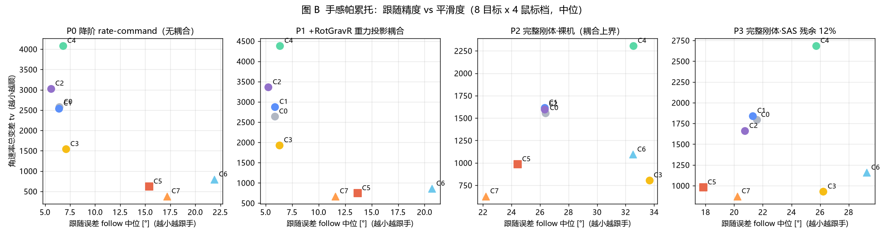
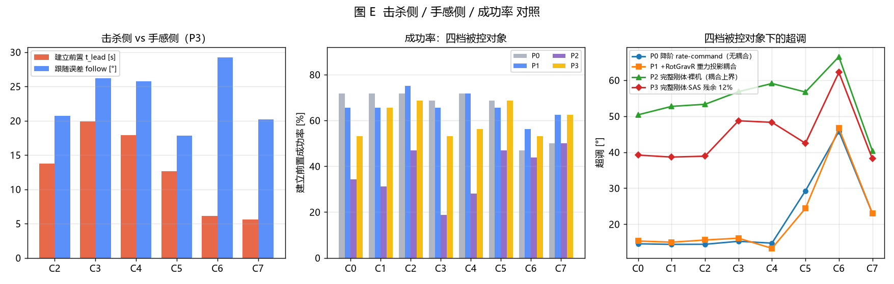
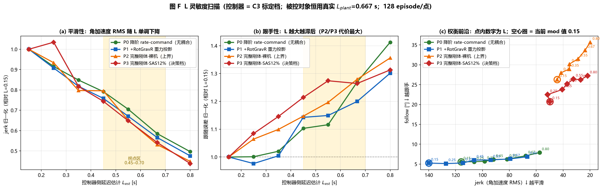
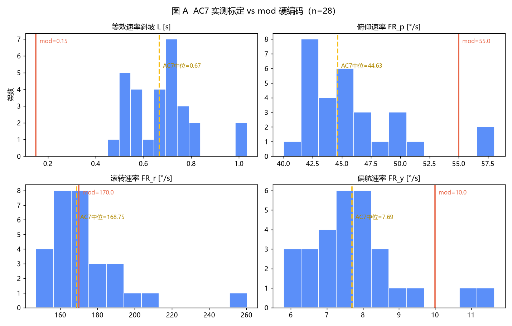

# 分析报告：纯 ZEM 与简化版战争雷霆飞控的对照

> 本文是 `issue_main.md` 背后的证据链。它比较两个候选制导律——**简化版战争雷霆飞控（下称 WT 飞控）**与**纯 ZEM**——并给出它们在真实耦合被控对象上的量化表现。
>
> 复现脚本在 `analysis_scripts/`，图表在 `analysis_reports_zem-wtpatent.assets/`。

---

## 0. 一页摘要

当前 AC8-Mouse-Aim 的几何控制律有两个已知短板：滚转通道追求固定 90° 坡度、偏航权限只有滚转的 5%，导致「方向稍歪就一直滚转」。本报告用一套统一仿真（1024 场景）比较了两种替换方案：

| 方案 | 一句话 | 关键收益（P3 档） |
|---|---|---|
| **WT 飞控** | 战争雷霆专利内环：前向仿真 + 点积评分选杆量 | 跟随 −17%，成功率 +16 pp，jerk −40% |
| **纯 ZEM** | 比例导引 N=3：`ω = 3·λ̇` | jerk −55%，超调最低，进包线 −19% |

两者互补：WT 飞控「跟手」，纯 ZEM「快而稳」。参数均用 AC7 数据标定，**接入 AC8 前应重标定**（见 §6）。

## 1. 方法

### 1.1 两类目标

按玩家的两个诉求把控制器分两类：

- **A 类（WT 飞控）**：鼠标操纵体验优先。对候选 (roll, pitch) 杆量做 N 步前向仿真，用「机头 · 目标」点积评分挑最优，代价含平滑正则与控制能量。不主动建前置角。
- **B 类（纯 ZEM / NemoFC）**：击杀优先。未进发射包线最小化进包线时间，已进包线最小化 ZEM。机头会离开鼠标去抢拦截点。

### 1.2 消融阶梯

每个 C_k 只比 C_{k−1} 多一处改动，收益可单独归因：

| 控制器 | 相对上一档的唯一改动 |
|---|---|
| C0 | AC8 原律（基线） |
| C1 | 平滑正则替换 `max(0.12f, up)` 硬钳位 |
| C2 | `LevelBlend` 迟滞 → 连续权重 |
| C3 | 标定 L = 0.667 |
| C4 | `L·ẇ` 逆模型前馈（实测变差，不推荐） |
| **C5** | **A 类：WT 飞控（专利内环）** |
| **C6** | **B 类：NemoFC（J6 分层，击杀效率）** |
| **C7** | **B 类：纯 ZEM/PPN（N=3）** |

### 1.3 被控对象四档

把「飞控（SAS/FBW）压掉多少气动耦合」当成未知量，扫四档：

| 档 | 定义 | 用途 |
|---|---|---|
| P0 | 降阶 rate-command，无耦合 | 等价 mod 作者的设计假设 |
| P1 | P0 + RotGravR 重力投影 | 只加物理上消不掉的那部分 |
| P2 | 完整刚体，耦合全开 | 耦合上界（裸机） |
| P3 | 完整刚体，SAS 残余 12% | **决策档**，代表 AC7/AC8 实际水平 |

**P3 是决策档。** 其余档用来给「FBW 压掉多少」定界。

### 1.4 规模

`8 控制器 × 8 目标机动 × 4 鼠标档 × 4 被控对象 = 1024 episode`，`dt = 0.02 s`，`T_max = 40 s`。numba CPU 单线程约 189 s（`num21_main.py`）。

## 2. 结果（P3 决策档）

### 表 1：P3 档全控制器对照（8 目标 × 4 鼠标档，中位数）

| 控制器 | 进包线 t_las | 建立前置 t_lead | 跟随 | 超调 | jerk | tv | 成功率 |
|---|---|---|---|---|---|---|---|
| C0 原律 | 3.62 | 2.48 | 21.57° | 39.20° | 53.32 | 1794 | 53% |
| C2 +连续权重 | 3.65 | 6.54 | 20.74° | 38.89° | 49.79 | 1660 | 69% |
| **C5 WT 飞控** | 2.96 | 10.26 | **17.84°** | 42.49° | 31.96 | 980 | **69%** |
| C6 NemoFC | **2.45** | 5.11 | 29.27° | 62.18° | 34.56 | 1158 | 53% |
| **C7 纯 ZEM** | 2.93 | 5.52 | 20.21° | **38.18°** | **23.95** | 873 | 62% |

**图 1**：击杀侧（t_las）与手感侧（jerk / tv）的 Pareto 前沿，四档被控对象分色。

**图 2**：左 = 击杀侧（t_lead）vs 手感侧（follow）；中 = 四档成功率；右 = 四档超调走势。P2/P3 的超调 39–65°，是 P0/P1 的 3–4 倍——这是气动交叉耦合 `C_lβ` 的账单。

### 解读

1. **WT 飞控（C5）是唯一三项全不输的控制器**：跟随 17.84°（全场最好）、进包线 2.96 s（接近最优）、成功率 69%（并列最高）。代价是建立前置慢到 10.26 s——这是「先跟手、后瞄准」的设计取向。
2. **纯 ZEM（C7）是被低估的中庸解**：jerk 23.95（手感侧最好）、超调 38.18°（全场最低）、进包线 2.93 s、成功率 62%。它主动建前置，所以跟随略逊于 WT 飞控，但手感更稳。
3. **NemoFC（C6）只换速度不换成功率**：进包线 2.45 s（全场最快，比基线快 32%），但跟随 29.27°、超调 62.18°，手感明显劣化。

## 3. 两类目标的分野

| 诉求 | 选型 | 依据 |
|---|---|---|
| 要手感（跟手、顺滑） | **WT 飞控（C5）** | 跟随 17.84°、jerk 31.96 |
| 要击杀速度 | NemoFC（C6） | 进包线 2.45 s，但跟随 29.27° |
| **两个都要** | **纯 ZEM（C7）** | 进包线 2.93、跟随 20.21°、jerk 23.95 |

这就是 `issue_main.md` 只提 WT 飞控与纯 ZEM 的原因：它们是「手感」与「手感 + 击杀」两个方向的最优代表，覆盖了玩家的两类诉求。

## 4. L 灵敏度与重标定依据

等效速率斜坡 `L` 只进入 `arrival_rate()` 的制动包络 `stoppable = √((a·L)² + 2a·d) − a·L`。它本质是「平滑 ↔ 跟手」旋钮。

**图 3**：L 从 0.15 扫到 0.80，四档被控对象的归一化曲线几乎重合。

关键事实：

- `jerk` / `tv` 在四档上都是 **0.44–0.50×**（高度一致）→ L 的取值不依赖 FBW 强度。
- `t_las` 几乎不随 L 变（±15%）→ 改 L 不牺牲击杀速度。
- 现值 0.15 三项平滑指标全最差，且没有任何一项能换回来。

FR 标定用的是 AC7 28 架实测表（`num20_fr_calib.py`）：

**图 4**：28 架的 L 与三轴 FR 分布，红虚线为 mod 硬编码。

| 量 | AC7 中位 | mod 硬编码 | 说明 |
|---|---|---|---|
| L [s] | 0.667 | 0.150 | **低估 4.4×** |
| FR 俯仰 [°/s] | 44.63 | 55.0 | 比率 1.23 |
| FR 滚转 [°/s] | 168.75 | 170.0 | 比率 1.01 |
| FR 偏航 [°/s] | 7.69 | 10.0 | 比率 1.30 |

FR 绝对值 mod 摸得准，但 L 差了 4.4 倍。L 被低估 → 制动包络偏窄 →「到位后停不住 / 超调振荡」。

## 5. 结论

1. 当前控制律的短板是结构性的（固定 90° 坡度 + 偏航权限 5%），不是调参问题。
2. WT 飞控与纯 ZEM 是两条互补的替换路线，覆盖「手感」与「手感 + 击杀」两类诉求。
3. 两者共享的前提是参数重标定：FR / L / 空速都来自 AC7，AC8 需要重测 T90/T360/roll/yaw。

## 6. 局限

1. **AC8 真实数据表未拿到**。本报告用 AC7 的 28 架实测表。角速率权限层面差异未兑现（比率 1.01–1.30），但 L 是否有代际差异无法验证。
2. **纯 ZEM 的 λ̇ 是干净几何**。仿真用的是真实 LOS，实际 mod 只能从鼠标 aim 估 λ̇（噪声大）或读游戏内存（范围大）。所以 ZEM 的数字是上界。
3. **鼠标模型来自文献幂律，不是本机实测**。
4. **cpl_s = 0.12 是猜测值**。SAS 压掉气动交叉耦合的比例没有公开数据，本报告把它变成扫描参数（P0–P3）。
5. **成功率偏低（53–69%）不代表控制律差**。目标集含「螺旋 barrel」这种全控制器 0 通过的科目，它把均值拉低了约 12 个百分点。
